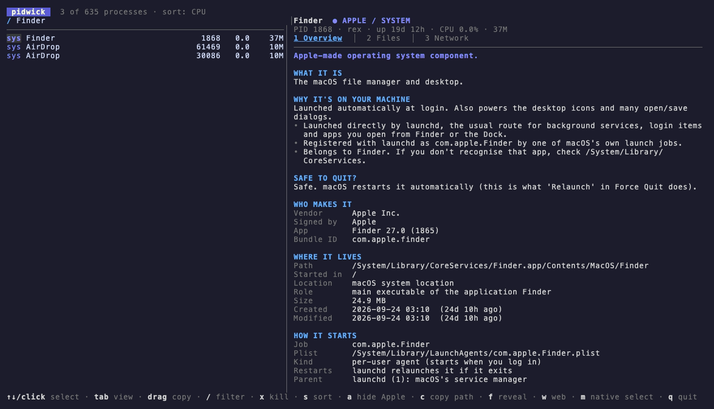

# Pidwick

A terminal companion to Activity Monitor. Activity Monitor tells you *what is
running*; Pidwick tells you **what it is, why it's there, who made it, whether
to trust it, and what it's touching**.

Built with [Bubble Tea](https://github.com/charmbracelet/bubbletea).



The demo is generated from [`demo.tape`](demo.tape) with [VHS](https://github.com/charmbracelet/vhs): `vhs demo.tape`.

## Install

Requires macOS and [Go](https://go.dev/dl/) 1.24 or newer.

```sh
go install github.com/rex-sheridan/pidwick@latest   # puts `pidwick` in $(go env GOPATH)/bin
```

or from a checkout:

```sh
git clone https://github.com/rex-sheridan/pidwick && cd pidwick
go build -o pidwick . && ./pidwick
```

Run it as your own user to inspect your own processes. Use `sudo pidwick` to also see the open
files and connections of root-owned processes (macOS hides them otherwise). Pidwick only reads
system state, except when you press `x` to send a signal after confirming.

## What it shows for the selected process

| Tab | Contents |
| --- | --- |
| **Overview** | What it is, why it's on your Mac, safe to quit?, vendor and code-signing identity, install location/source (app bundle, pkg, Homebrew), how launchd starts it, a trust check, command line, family tree |
| **Files** | Working directory, open files, devices, pipes/sockets, third-party code loaded |
| **Network** | Listening ports (and whether they're reachable beyond localhost), live connections with reverse-DNS names |

The **trust check** is a transparent heuristic (code signature, Gatekeeper /
notarization, location, impersonation of Apple process names, persistence,
listening sockets). It is not an antivirus; each finding explains itself.

## Mouse and keyboard

- **Click** a process to select it; click a tab to switch; click the filter row to search; wheel scrolls.
- **Select text** in the detail pane by dragging; **double-click** selects a word
  (paths and IDs stay whole), **triple-click** a line. Releasing copies to the clipboard.
  Pidwick implements this itself because terminals stop selecting once an app captures the mouse.
  `m` releases the mouse so your terminal's own selection works (press `m` again to restore clicking).
- `y` copies the whole current view.
- **Kill** with `x`: a confirmation offers `t` terminate (SIGTERM), `k` force kill (SIGKILL), or `a`
  terminate the process and all its descendants. It warns about system components, launchd
  auto-restart, other users' processes and child processes, and refuses PID 1 and Pidwick itself.

`↑↓`/`jk` select · `tab`/`1-3` view · `J`/`K` scroll · `/` filter · `s` sort · `a` hide Apple/system ·
`r` rescan selected · `f` reveal in Finder · `c` copy path · `w` web search · `q` quit

## How it gathers data

`ps`, `lsof`, `codesign`, `spctl`, `pkgutil`, `launchctl`, launchd plists,
app `Info.plist`s and a built-in knowledge base of well-known macOS processes
(`internal/proc/kb/*.json`, ~430 entries plus pattern rules for widgets, App Intents, Storage and DriverKit processes; entries marked `inferred` are deduced from the name and framework rather than documented).

## Limitations

- macOS only. It shells out to `ps`, `lsof`, `codesign`, `spctl`, `pkgutil` and `launchctl`, so it
  is slower and shallower than tools that call macOS APIs directly.
- The trust verdict is a set of rules, not malware detection, and there is no VirusTotal lookup.
- The built-in descriptions are hand-written. Entries marked "inferred" are deduced from names and
  framework paths, not from Apple documentation, and some may be wrong. Corrections welcome.
- No resource graphs, thread views, priority control or suspend/resume.

## Related projects

Pidwick is an *explainer* more than a monitor. If you need something else, these are worth a look:

- [TaskExplorer](https://objective-see.org/tools.html) (Objective-See): mature GUI for spotting
  malware, with signature status, loaded libraries, files and connections.
- [Process Explorer for Mac](https://github.com/microsoft/Procexp-Mac): Windows Process Explorer
  style GUI with process trees, handles, VirusTotal and deep process control.
- [ProcLens](https://github.com/canberkys/proclens): native Task Manager style app with launchd management.
- [pstop](https://github.com/lu-zhengda/pstop): another Bubble Tea process browser for the terminal.
- [Process Viewer](https://github.com/g-baskin/process-viewer): desktop app with plain-English process descriptions.
- [launchk](https://github.com/mach-kernel/launchk): terminal browser for launchd jobs.
- `htop`, `btop`, [mactop](https://github.com/context-labs/mactop): resource monitors for the terminal.

## License

MIT. See [LICENSE](LICENSE).
